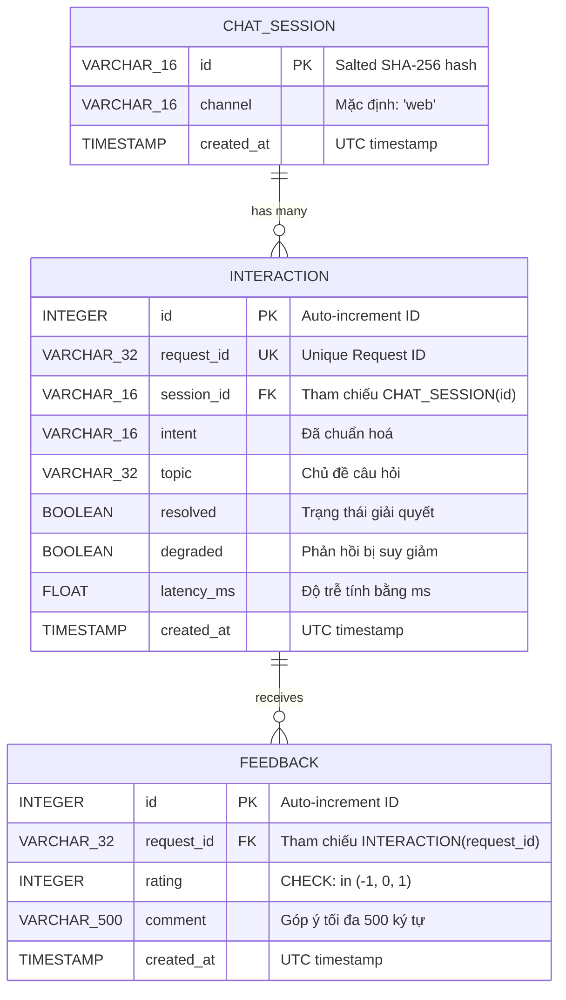

# Lab 5 — Data model worksheet

## 1. Critique the bad schema (sql/bad_schema.sql)
| # | Problem | Why it hurts | Fix |
|---|---|---|---|
| 1 | **Lưu trữ PII (Personally Identifiable Information) trực tiếp:** `student_name`, `student_phone`, `message` raw | Vi phạm nghiêm trọng luật bảo vệ dữ liệu (GDPR/PDPA). Nếu cơ sở dữ liệu bị lộ, toàn bộ danh tính và nội dung câu hỏi riêng tư của sinh viên bị công khai. | Loại bỏ cột `student_name`, `student_phone`. Không lưu câu hỏi raw (`message`), chỉ ẩn danh hoá hoặc chỉ lưu siêu dữ liệu phân tích (`intent`, `topic`). |
| 2 | **Thiếu chuẩn hóa dữ liệu (Unnormalized - Vi phạm 1NF, 2NF, 3NF):** Trộn lẫn session, tương tác và feedback trong một bảng lớn | Dư thừa dữ liệu (tên, số điện thoại lặp lại ở mỗi tin nhắn). Cột `feedback` chứa giá trị phức `'1,-1,1'` vi phạm 1NF (nguyên tử hóa), không thể truy vấn hoặc tính điểm trung bình bằng SQL thuần. | Tách thành 3 bảng riêng biệt theo quan hệ: `chat_session` (phiên chat), `interaction` (từng câu hỏi/phản hồi), và `feedback` (đánh giá). |
| 3 | **Thiếu ràng buộc toàn vẹn & Khóa chính (No Primary Key, Foreign Key):** `id INTEGER` không có `PRIMARY KEY` | Dễ bị trùng lặp dữ liệu, không đảm bảo tính duy nhất, tốc độ truy vấn chậm do không có chỉ mục (index), và không đảm bảo toàn vẹn tham chiếu giữa các thực thể. | Đặt `PRIMARY KEY` cho từng bảng, dùng `FOREIGN KEY` (vd: `interaction.session_id REFERENCES chat_session(id)`). |
| 4 | **Sai kiểu dữ liệu thời gian (`time TEXT`):** Lưu dạng chuỗi như `'5/10/2026 9:03 PM'` | Không thể so sánh (`>`, `<`), sắp xếp (`ORDER BY`), hoặc lọc theo khoảng thời gian (`BETWEEN`) một cách chính xác và hiệu quả. | Sử dụng kiểu dữ liệu `TIMESTAMP` chuẩn ISO 8601 UTC. |
| 5 | **Sai kiểu dữ liệu hiệu năng (`latency TEXT`):** Lưu chuỗi `'120ms'` | Không thể tính toán tổng hợp (như `AVG(latency)`, `MAX`, `MIN`) bằng các hàm toán học của SQL. | Dùng `FLOAT` hoặc `INTEGER` biểu thị mili-giây (ví dụ: `latency_ms FLOAT`). |
| 6 | **Giá trị `intent` là chuỗi tự do (Free text: `'fee'`, `'Fee'`, `'FEE'`):** Không có ràng buộc giá trị chuẩn hóa | Gây sai lệch khi thống kê, nhóm dữ liệu (`GROUP BY intent`) hoặc tìm kiếm do phân biệt hoa thường và chính tả không đồng nhất. | Chuẩn hóa `intent` thành lowercase hoặc dùng enum/ràng buộc `CHECK`, giới hạn độ dài `VARCHAR(16)`. |

---

## 2. Store or not? (privacy-aware storage)
| Data | Store? | Form (raw / hashed / aggregated / none) | Retention | Reason |
|---|---|---|---|---|
| raw user message | **No** | none | 0 days | Tránh lộ dữ liệu nhạy cảm hoặc câu hỏi cá nhân của sinh viên; hệ thống chỉ cần intent để hỗ trợ và cải tiến. |
| session id | **Yes** | hashed (SHA-256 + secret salt) | 30 days | Phục vụ phân tích hội thoại theo phiên (session) mà không thể truy ngược danh tính người dùng nếu salt được bảo mật trong `.env`. |
| intent, latency, topic | **Yes** | raw / categorical | 90 days | Dữ liệu phi cá nhân, phục vụ trực tiếp cho việc theo dõi hiệu năng hệ thống, độ trễ và phân tích xu hướng thắc mắc của sinh viên. |
| feedback rating | **Yes** | raw (int: -1, 0, 1) | 90 days | Dùng để đo lường mức độ hài lòng (CSAT), đánh giá chất lượng câu trả lời của trợ lý. |
| feedback comment | **Yes** | raw (optional, ≤ 500 chars) | 30 days | Giúp đội ngũ phát triển đọc góp ý để cải thiện, nhưng cần thời gian lưu trữ ngắn và kiểm duyệt tránh PII. |
| student name / phone | **No** | none | 0 days | Vi phạm bảo mật quyền riêng tư; trợ lý học tập không cần thông tin danh tính thực tế này để xử lý nghiệp vụ. |

---

## 3. Product questions → fields
| Product question | Fields needed | Table(s) | Query sketch |
|---|---|---|---|
| Most failed intent? | `intent`, `resolved`, `degraded` | `interaction` | `SELECT intent, COUNT(*) AS failures FROM interaction WHERE resolved = 0 OR degraded = 1 GROUP BY intent ORDER BY failures DESC LIMIT 1;` |
| Average response time by intent? | `intent`, `latency_ms` | `interaction` | `SELECT intent, AVG(latency_ms) AS avg_latency FROM interaction GROUP BY intent ORDER BY avg_latency DESC;` |
| Top unresolved topics? | `topic`, `resolved` | `interaction` | `SELECT topic, COUNT(*) AS count FROM interaction WHERE resolved = 0 AND topic IS NOT NULL GROUP BY topic ORDER BY count DESC LIMIT 5;` |

---

## 4. ER diagram & Giải pháp kiến trúc Lab 5

### Cách thiết kế 3 bảng giải quyết các vấn đề của bad_schema

#### 1. Bảng `chat_session` — Xử lý triệt để rò rỉ danh tính (PII) & Chuẩn hóa vòng đời phiên
- **Vấn đề ở `bad_schema`:** Bảng cũ lưu trực tiếp `student_name`, `student_phone` lặp lại ở mọi câu chat $\rightarrow$ Vi phạm nghiêm trọng GDPR/PDPA và gây dư thừa dữ liệu khổng lồ.
- **Giải pháp Lab 5:**
  - **Xóa bỏ hoàn toàn PII:** Không lưu tên hoặc số điện thoại sinh viên vào database.
  - **Khóa chính ẩn danh 1 chiều (`id`):** Dùng `hash_session(raw, salt)` (SHA-256 + secret salt trong `.env`), chỉ lưu chuỗi băm 16 ký tự. Kẻ tấn công có mã nguồn hoặc dump database cũng không thể dịch ngược danh tính sinh viên.
  - **Chuẩn hóa quan hệ 1-N:** Gom thông tin phiên lại một chỗ, mỗi phiên chỉ tốn đúng 1 bản ghi thay vì nhân bản theo từng tin nhắn.

#### 2. Bảng `interaction` — Xử lý vi phạm chuẩn hóa (1NF/2NF) & Chuẩn hóa kiểu dữ liệu
- **Vấn đề ở `bad_schema`:** 
  - `message TEXT`: Lưu câu hỏi thô suốt đời, dễ lộ dữ liệu nhạy cảm nếu sinh viên vô tình gõ vào.
  - `intent TEXT`: Nhập tự do (`'fee'`, `'Fee'`, `'tuition'`), không thể `GROUP BY` đồng nhất.
  - `time TEXT`, `latency TEXT`: Dùng kiểu chuỗi (`'5/10/2026 9:03 PM'`, `'120ms'`), không thể so sánh thời gian hay tính toán thống kê `AVG(latency)`.
  - Không có khóa chính (`PRIMARY KEY`), không có khóa ngoại (`FOREIGN KEY`).
- **Giải pháp Lab 5:**
  - **Bảo vệ quyền riêng tư:** Không lưu `message` thô. Chỉ trích xuất metadata kỹ thuật (`intent`, `topic`, `resolved`, `degraded`, `latency_ms`) phục vụ đo lường và cải tiến hệ thống.
  - **Chuẩn hóa kiểu số & thời gian:** `latency_ms FLOAT` cho phép tính toán tức thì (`AVG`, `MAX`, `MIN`); `created_at TIMESTAMP` cho phép lọc/sắp xếp thời gian chính xác và đánh index tối ưu hiệu năng (`ix_interaction_created_at`).
  - **Toàn vẹn tham chiếu:** Khóa ngoại `session_id REFERENCES chat_session(id)` đảm bảo mọi tương tác đều thuộc về một phiên hợp lệ, ngăn chặn dữ liệu mồ côi.

#### 3. Bảng `feedback` — Xử lý vi phạm tính nguyên tử (1NF) & Tách rời đánh giá
- **Vấn đề ở `bad_schema`:** Cột `feedback TEXT` lưu danh sách chuỗi gộp `'1,-1,1'` $\rightarrow$ **Vi phạm nghiêm trọng dạng chuẩn 1 (1NF)**; không thể truy vấn đếm rating hay tính điểm hài lòng (CSAT) bằng SQL thuần.
- **Giải pháp Lab 5:**
  - **Đạt chuẩn 1NF (Nguyên tử hóa):** Mỗi lần người dùng gửi đánh giá sẽ được ghi thành một bản ghi độc lập có `id` riêng.
  - **Ràng buộc miền giá trị:** Ràng buộc `CHECK (rating IN (-1, 0, 1))` chặn hoàn toàn dữ liệu sai lệch ngay từ tầng database.
  - **Tách rời vòng đời (Decoupling):** Chat xong thì lưu ngay vào `interaction`. Đánh giá là tùy chọn (optional) của người dùng; khi có đánh giá, liên kết qua `request_id REFERENCES interaction(request_id)` mà không tạo ra các ô `NULL` lãng phí trên bảng `interaction`.

---

### Sơ đồ quan hệ thực thể (ERD)


### Rà soát cơ chế bảo mật danh tính (Privacy Audit & Verification)

#### 1. Luồng dữ liệu và Mã nguồn thực thi
Cơ chế băm ẩn danh hoá danh tính người dùng được cấu hình và vận hành xuyên suốt qua các tầng:

- **Nạp Salt bảo mật:** Tại `assistant_core/config.py`:
  ```python
  session_salt: str = Field(default="dev-salt", repr=False)
  # Đọc từ biến môi trường: os.getenv("SESSION_SALT", "dev-salt")
  ```
  > 💡 **Điểm an toàn (`repr=False`):** Khi đối tượng `Settings` bị in ra console hoặc ghi vào hệ thống log để debug, giá trị `session_salt` **không bao giờ bị lộ ra log**.

- **Hàm băm cốt lõi:** Tại `assistant_api/db.py`:
  ```python
  def hash_session(raw: str, salt: str) -> str:
      return hashlib.sha256((salt + raw).encode()).hexdigest()[:16]
  ```

- **Lưu trữ CSDL:** Tại `Repository.record_interaction()`:
  ```python
  sid = hash_session(raw_session, self.salt)
  ```
  Chỉ chuỗi băm `sid` được lưu vào cột khóa chính của bảng `chat_session`, `raw_session` bị huỷ bỏ khỏi bộ nhớ ngay sau đó.

#### 2. Phân tích tính an toàn kỹ thuật (Đảm bảo không bị dịch ngược danh tính)
- **Tính chất kháng tiền ảnh của SHA-256 (Pre-image Resistance):** Thuật toán **SHA-256** là hàm băm một chiều mật mã học tiêu chuẩn NIST. Theo nguyên lý toán học, không tồn tại hàm giải mã ngược từ giá trị hash về chuỗi gốc ($f^{-1}(hash) \rightarrow message$). Cách duy nhất là vét cạn (brute-force) với độ phức tạp tính toán bất khả thi $O(2^{256})$.
- **Khử hoàn toàn tấn công Rainbow Table nhờ Secret Salt (`SESSION_SALT`):**
  - Trong thực tế, sinh viên thường truyền `session_id` là Mã số sinh viên (MSSV, ví dụ: `21127001` - chỉ có 8 chữ số, không gian chỉ khoảng $10^8$ khả năng). Nếu không có salt, kẻ tấn công có thể dựng sẵn Rainbow Table cho toàn bộ ~20,000 sinh viên để tra ngược danh tính trong vài mili-giây.
  - Khi thêm `SESSION_SALT` bí mật (được nạp từ tệp môi trường `.env` và cấm commit lên Git theo `.gitignore`), dữ liệu băm trở thành $\text{SHA-256}(\text{SESSION\_SALT} + \text{MSSV})$. Kẻ tấn công dù có database dump và danh sách MSSV toàn trường cũng **hoàn toàn vô hiệu hóa**, vì không thể tính trước hash nếu không sở hữu secret salt.
- **Cắt ngắn 16 ký tự Hex (`hexdigest()[:16]` = 64-bit entropy):**
  - Cung cấp $16^{16} = 2^{64} \approx 1.84 \times 10^{19}$ giá trị khác nhau. Theo nghịch lý ngày sinh (Birthday Paradox), hệ thống cần tới hơn **4 tỷ phiên chat** mới có 50% nguy cơ trùng lặp (collision) $\rightarrow$ Tuyệt đối an toàn cho quy mô trường học.
  - Cắt ngắn còn làm **mất thông tin có chủ đích** (information loss), triệt tiêu hoàn toàn khả năng dò lại độ dài gốc của `raw_session`.

#### 3. Mô hình đe dọa (Threat Modeling)

| Kịch bản tấn công | Khả năng phòng thủ | Đánh giá |
|---|---|---|
| **Kẻ xấu đánh cắp file CSDL (`assistant.db`)** | CSDL chỉ chứa chuỗi 16 ký tự đã hash (VD: `a7f9c2e1b4d089e3`). Không có bảng user, không có `raw_session`. Kẻ xấu không thể biết sinh viên nào đã hỏi gì. | 🟢 **An toàn tuyệt đối** |
| **Kẻ xấu biết mã nguồn và danh sách MSSV toàn trường** | Dù biết mã nguồn công khai, nhưng `SESSION_SALT` nằm độc quyền trong file `.env` trên máy chủ (đã cấu hình trong `.gitignore`). Không có salt $\rightarrow$ không thể brute-force. | 🟢 **An toàn** |
| **Rò rỉ qua Log / Traceback của server** | Cấu hình `repr=False` tại Pydantic Settings ngăn chặn salt in ra màn hình hoặc log console. | 🟢 **An toàn** |

#### 4. Kiểm chứng qua Unit Test (Verification)
Trong file `tests/test_db.py`, bài test tự động đã kiểm chứng 2 điều kiện tiên quyết:
```python
assert s.id == hash_session("student-42", "salt") and "student-42" not in s.id
```
1. ID lưu trong bảng `chat_session` là giá trị hash nhất quán.
2. Chuỗi định danh gốc (`student-42`) tuyệt đối **không bao giờ xuất hiện** trong CSDL.

#### 5. Kết luận nghiệm thu (Definition of Done)
✅ Cơ chế băm `session_id` của Trợ lý đáp ứng đầy đủ tiêu chuẩn bảo vệ dữ liệu cá nhân (GDPR/PDPA):
- Đảm bảo tính ẩn danh một chiều (bất khả nghịch).
- Chống tấn công Rainbow Table và từ điển thành công nhờ `SESSION_SALT`.
- Ngăn chặn rò rỉ salt vào log nhờ `Field(..., repr=False)`.
