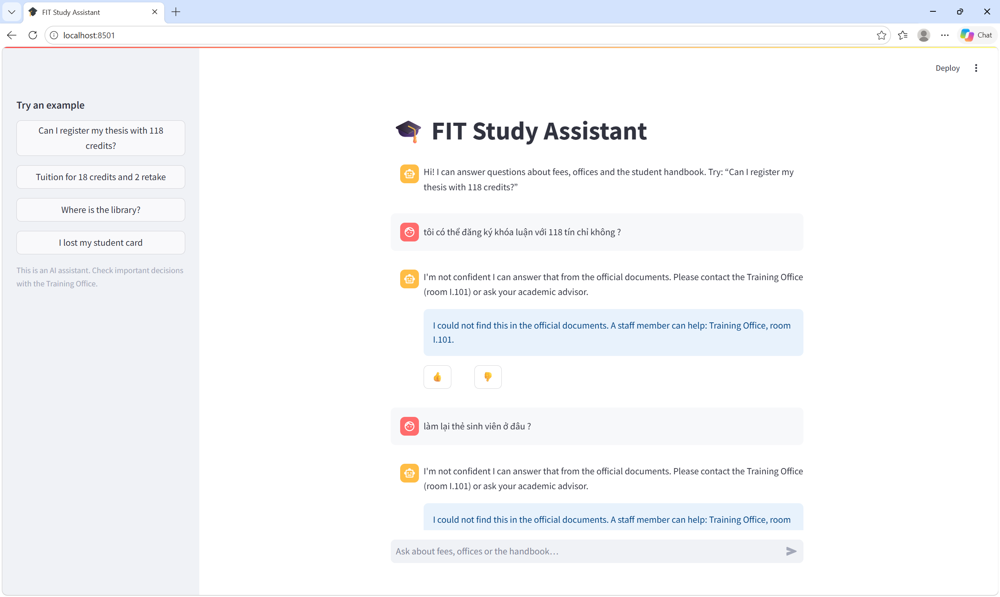
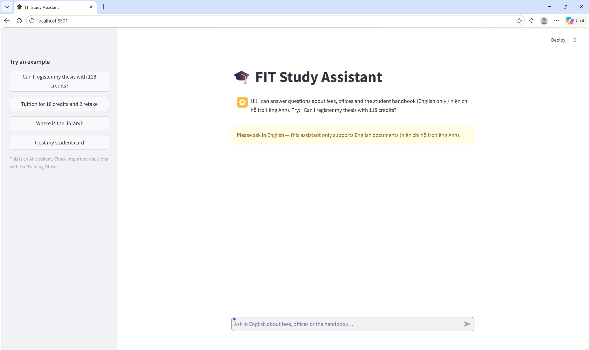

# Lab 7 homework — 10-minute usability test

Tester (not in your team, first name only): Nhật Huy  Date: 26/11/2026
Task you gave them: "Find out if you can register your thesis with 118 credits, and where to replace a lost student card."

Rule: do not help or explain. Watch and write down what happens.

| # | What the tester did or said | What they expected | Why the system/UI caused it | Fix idea |
|---|---|---|---|---|
| 1 | Typed the task question in Vietnamese ("tôi có thể đăng ký khóa luận với 118 tín chỉ không ?") and saw an escalation message telling them to contact the Training Office. | Expected the assistant to answer in Vietnamese or clearly state that only English is supported. | `WELCOME` and the chat input placeholder never mentioned that the knowledge base and assistant only support English. | State "English only / hiện chỉ hỗ trợ tiếng Anh" in `WELCOME` and the input placeholder, and warn politely in `validate_input()` when Vietnamese characters are detected. (Implemented) |
| 2 | Clicked 👍 / 👎 under an answer; after the small toast disappeared, looked back at the message and saw nothing below `Sources:`. | Expected a persistent confirmation (or selected state) showing their feedback was saved. | `ui/app.py` removes the 👍 / 👎 buttons as soon as `rid` is added to `st.session_state.rated` without rendering a confirmation label. | Show a persistent caption (e.g., `✓ Thanks for your feedback!`) once `rid in st.session_state.rated`. |
| 3 | Opened the chat page without expanding the left sidebar and only saw one example in the welcome text, and when escalation occurred saw two nearly identical Training Office notices stacked together. | Expected quick-click example questions (including student card replacement) and a single clear non-repetitive notice. | Example buttons and the AI disclaimer live inside `st.sidebar` (collapsed on narrow/mobile screens), and both the backend abstain reply and `status_note()` display the Training Office message. | Surface example buttons and the AI notice on the main screen, or avoid duplicating the escalation text in `ui/app.py`. |

The one change we made (commit link): https://github.com/hoanghaiviet100-creator/lab03_maintainable/commit/74dbc2215b385804b87018450d57356681a6e5cd
Before / after screenshot:

**Before:**

**After:**

